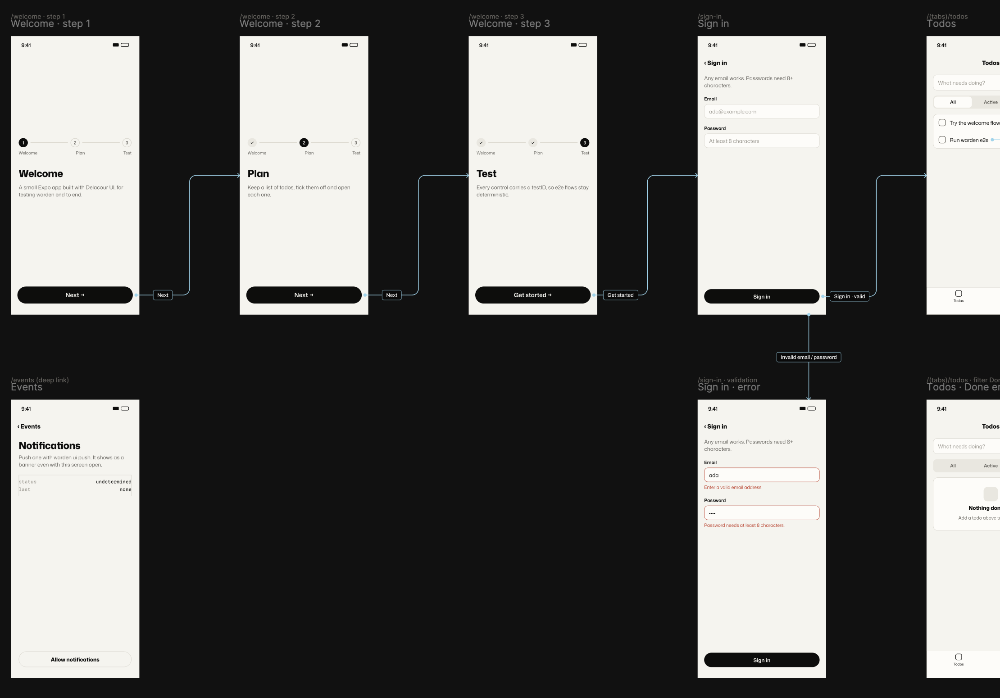
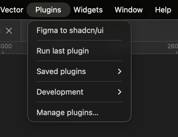
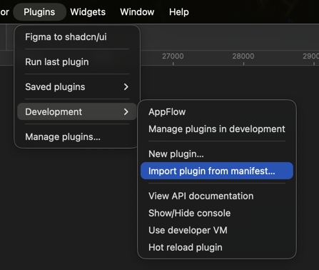
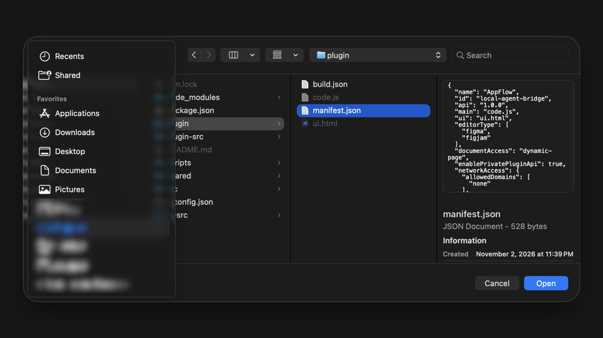
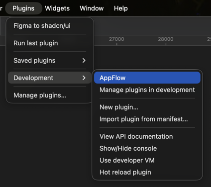
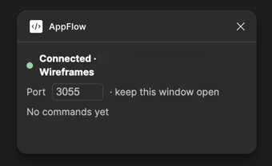

# appflow

Let Claude lay out your app's flows in Figma and keep the file's components in sync with your code. Two jobs:

- **App flow boards.** Turn your routes into a board of screens that reads left to right, with arrows that start at the control that triggers them and a working prototype. Each screen carries a Built, Drift or Not built badge, checked against the code and the running app.
- **Component and design-system sync.** Code is the source of truth. Tokens, text styles and `tailwind-variants` components flow from code into Figma variables, text styles and component sets, styled and bound to the synced variables.



AppFlow is a local MCP server plus a Figma development plugin, working on the file open in the Figma desktop app. It also exposes the Figma MCP server's read tools under the same names. No Figma MCP plan or Dev Mode seat needed.

## Quick start

1. [Install the plugin](#1-install-the-figma-plugin) and open it in your file.
2. [Add the server to Claude Code](#2-add-the-server-to-claude-code).
3. Ask Claude in plain words. For example:
   - "Build a flow board for this app's routes, onboarding first, sign-in errors below."
   - "Adopt the board on this page and fix any arrows that point left."
   - "Which screens on this board are built? Check the code and the running app."
   - "Sync the tokens, text styles and components from code. Dry run first."

Claude calls `figma_status` first to find the open file, then the board or sync tools below.

## App flows

A flow board is a grid of screens. It reads like a sentence:

- The main path runs left to right, one column per step.
- Branches (errors, alternate outcomes, retries) go straight down under their source.
- Overlays and entry points sit straight above the screen they open over.
- Arrows point right, down or up, never left. A return to an earlier step becomes a state copy of that screen, not a loop back.
- Each arrow starts at the button, row, tab or link that triggers it, and `connect` points that control's prototype at the target, so Play works.

Screens stay top-level frames so prototype Play and flow starting points work. Above each one sit its route text (the code path) and its build badge. The board tools move a screen, its route and badge together and redraw the arrows, so the board never drifts out of shape.

### Workflow

1. **Get a board.** `create_board` for a new flow, or `adopt_board` (dry run first) on a hand-built one.
2. **Read it.** `describe_board` prints the grid as ASCII, one cell per screen, plus every arrow and its trigger.
3. **Agree the layout.** Claude proposes the target grid in the same format before moving anything:

   ```
         c0            c1               c2
   r0 | Verify ID  | Home·pending   |
   r1 | Bastion    | You're verified|
   r2 | Couldn't   | Expired        | Bastion·new link
   ```

4. **Place screens.** `move_screen` (with `swap`), `insert_columns` / `insert_rows`, `compact_board`, and `duplicate_screen` for state copies.
5. **Connect.** `connect({ from, to, trigger, label })`. Leave out `trigger` only for automatic transitions (timer, webhook, redirect).
6. **Check.** `lint_flow_layout`, `describe_board`, one screenshot. Done when all three are clean.

The full rules are in the `flow-layout` skill (`skill://appflow/flow-layout/SKILL.md`).

### Build status

Each screen shows whether it exists in code and still matches the design:

| Badge | Status | Meaning |
| --- | --- | --- |
| Built (green) | `built` | The route exists and the code and running app match the frame. |
| Drift (amber) | `drift` | The route exists, but the code or the app differs from the frame. |
| Not built (grey) | `not-built` | No code for this screen or state yet. |

The `verify-built` skill compares each screen's route code and the running app with its frame, then calls `set_screen_status`. A screen is never marked built just because its file exists. Run a design sync first, so colour and spacing differences from stale variables are not mistaken for drift.

### Board tools

| Tool | What it does |
| --- | --- |
| `create_board` | Empty board: heading, background sized for cols × rows, and an arrows frame kept above the screens. Copies styles from an existing board on the page. |
| `adopt_board` | Makes a hand-built board manageable: infers the grid, records each screen, and groups each arrow with its start dot and label, linked to its screens and trigger. |
| `describe_board` | The board as text: ASCII grid with build marks (✓ built, ~ drift, · not built), screens with routes and status, arrows, flow groups as a tree, and issues. |
| `move_screen` | Moves a screen (with route and badge) to a cell, or swaps two. Grows the board and reroutes arrows. |
| `insert_columns` / `insert_rows` | Shift later columns right or rows down to make room. |
| `compact_board` | Closes empty columns and rows and shrinks the board. |
| `duplicate_screen` | Copies a screen into a free cell for another state, optionally changing its banner. The copy starts Not built. |
| `connect` | Draws an arrow from the triggering control and points its prototype at the target. |
| `reroute_flow` | Redraws arrows from current positions after moves outside the board tools. Reports backwards and dangling arrows. |
| `create_flow_group` / `update_flow_group` / `delete_flow_group` | Labelled box (stroked rectangle plus bold title) around a set of screens, one level of nesting. Boundaries widen and boxes refit automatically when screens are added, moved or removed. |
| `adopt_flow_groups` | Converts hand-drawn boxes and Section Heading instances into flow groups. Dry run by default. |
| `lint_flow_layout` | Reports arrows whose head points left or whose path runs left, and flow group boxes that cross screens, labels or each other. |
| `set_screen_status` | Records `built` / `drift` / `not-built` and shows the badge. Follow `verify-built` first. |
| `badge_screens` | Adds or refreshes the badge on every screen of a board. |
| `ungroup_screens` | Migrates older boards whose screens sit in `Screen · …` groups back to top-level frames. |
| `group_screens` | Legacy. Breaks prototype Play; not for boxes, use `create_flow_group`. |

## Component and design-system sync

Code is the source of truth for variables, text styles and component variants. AppFlow reads your code design system, diffs it against the open file and brings Figma in line:

- **Tokens** (Tailwind v4 / Uniwind CSS) become variable collections with modes, aliases, scopes, code syntax and code ids. Primitives stay linked.
- **Type roles** become text styles. A font Figma does not have is an error, never a guess.
- **Components** (`tailwind-variants` `tv()` exports) become component sets: axes and options renamed or added, missing sets created on a "Code components" page, and each variant painted from its code classes, bound to the synced variables.

Every sync is a dry run by default. Read the plan, apply it with `dryRun: false`, and confirm that only orphans are left. Figma-only items are never removed unless you pass `prune: true`. The `sync-from-code` skill (`skill://appflow/sync-from-code/SKILL.md`) walks Claude through it.

### Sync tools

| Tool | What it does |
| --- | --- |
| `diff_design_system` | Compares the code design system with the file. Returns create, update and orphan ops plus rename candidates. Changes nothing. |
| `sync_design_system` | Runs `sync_tokens`, `sync_text_styles` and `sync_components` in that order (or the kinds in `include`) with the same `dryRun` and `prune`. |
| `sync_tokens` | Creates collections, modes and variables, renames matched variables to code names, sets values and aliases. |
| `sync_text_styles` | Makes text styles match the code type roles. |
| `sync_components` | Makes component sets match the code components and, with `styling` (default true), paints each variant from its classes. Run `sync_tokens` first. |
| `export_design_system` | The file's variables, text styles and components as DesignSpec JSON. |

### Configure: `appflow.design.json`

Put it at the project root. It says where the code design system lives and how Figma names map to code names:

```json
{
  "sources": [{ "kind": "tailwind-css", "paths": ["src/styles/tokens.css", "src/styles/theme.css"], "modes": ["dark"], "textStylePrefix": "Sony FT/" }],
  "rename": { "tokens": { "Tokens/text/text-2": "Tokens/color/muted-foreground" }, "textStyles": {}, "components": { "Notice": "Alert" } },
  "ignore": { "tokens": ["Primitives/*"], "textStyles": [], "components": [] }
}
```

- `sources` lists where the code spec comes from. Paths must stay inside the project.
  - `tailwind-css` reads Tailwind v4 / Uniwind CSS in cascade order. `@theme` `--color-<ramp>-<step>` literals become `Primitives` (`glacier/500`). `@theme inline` `--color-X: var(--X)` becomes `Tokens` `color/X`, with one value per `@variant light|dark` (limit them with `modes`). `--radius-*`, `--spacing-*` and `--text-*` become floats; `--radius` is `radius/base`. A `var()` to another token is an alias. `calc()`, `oklch()`, `rgb()` and `color-mix(in oklch, …)` are resolved. `--text-<role>` with `--line-height`, `--letter-spacing` or `--font-weight` becomes a text style named `textStylePrefix` + `Role name`. Anything else is reported as a warning. Options: `modes`, `primitives`, `tokens` (collection names), `textStylePrefix`, `fontFamily`.
  - `tailwind-variants` maps a component name to the `path#export` of its `tv()` result, or to `{ "ref": "…", "axes": ["status", "variant"] }` to pick the axes that become variants (leave behaviour flags such as `isLoading` out; `[]` for none). An axis left out is fixed at its code default, so its default classes still style the component. Only listed files are imported, in a child `bun` process with the project as its working directory, so the project's imports and tsconfig paths resolve and none of its code runs in the server. It runs after the token sources, so classes bind to their tokens.
  - `spec-json` is a DesignSpec file (`shared/design-spec.ts`); missing lists default to empty.
- `rename` maps a Figma token key (`Collection/name`), text style name or component name to its code name. It seeds the first match.
- `variants` maps a Figma component's axis to its code axis and options: `{ "Notice": { "Tone": { "axis": "status", "options": { "Error": "destructive" } } } }`.
- `variantDefaults` sets the option existing variants take when an axis is added: `{ "Alert": { "variant": "notice" } }`. Default: the code default.
- `layers` maps a code slot to the Figma layer it styles: `{ "Notice": { "title": "Text", "indicator": "Icon" } }`. Default: a layer named like the slot; `root` is the variant itself. Map a slot to `"root"` to paint the variant with it (an OTP `slot` that is the whole component), or to `""` to skip a slot the Figma component does not draw. Several components can use one `tv()` export (`List row` and `Toggle row` both on `item`); each pairs with the Figma component of its own name. A single component (not a variant set) is linked and styled but gets no axes.
- `ignore` takes globs where `*` matches anything, `/` included. They apply to both sides.

Matching order: the code id stored on the Figma item (shared plugin data `appflow` / `codeId`), then `rename`, then the same name. Floats match within 0.001 and colours within 1 per channel. A code literal equals a Figma alias that resolves to it, so links to primitives survive. Line heights and tracking compare in px at the font size, so `-1%` at 22 equals `-0.22px`. Two single-mode collections match whatever their modes are called. Figma items that match nothing are reported as orphans and are never removed by a diff. An orphan with exactly one unclaimed code lookalike is listed as a rename candidate.

Styling reads `bg-*`, `border-*`, `rounded-*`, `h-*`/`w-*`/`size-*`, `p*-*`, `gap-*`, `text-<size|colour>`, `font-<weight>`, `opacity-*`, `flex-row`/`flex-col`, `items-*` and `justify-*`. A class that names a token binds its variable; scale steps (`gap-1.5`) become numbers. Everything else, including state prefixes (`active:`) and arbitrary values, is listed as not expressible. A layer whose code fixes both width and height but sets no padding (an icon button) gets those padding sides zeroed, so padding left over from the design cannot push the size out.

Plans come back as one line per op (`+` create, `~` update, `?` Figma only); pass `verbose: true` for the full JSON. Run a sync with `dryRun` first, read the plan, then run it with `dryRun: false`; the result includes what is left, which should be orphans only.

### CI drift check

With the plugin open on the file, this exits 1 when Figma is behind the code (orphans do not count):

```sh
bun run scripts/call.ts diff_design_system '{"projectRoot":"/path/to/app","includeComponents":true}' \
  | jq -e '.counts.create + .counts.update == 0'
```

### Code Connect

`get_context_for_code_connect`, `get_code_connect_suggestions`, `get_code_connect_map`, `add_code_connect_map` and `send_code_connect_mappings` map Figma components to code components. Mappings are stored locally in `~/.appflow/code-connect.json` and are not synced with Figma's Code Connect.

## Setup

Needs [Bun](https://bun.sh), the Figma desktop app and [Claude Code](https://claude.com/claude-code).

```sh
git clone https://github.com/delacournz/appflow.git
cd appflow
bun install && bun run build
```

### 1. Install the Figma plugin

**Shortcut:** `bun run setup` installs, builds and adds AppFlow to Plugins → Development for you. If Figma is open it quits and reopens it, because Figma rewrites its settings on quit. Pass `--no-restart` to `bun run scripts/install-plugin.ts` to refuse instead, or `--dry-run` to print the change. A backup goes to `settings.json.appflow-backup` beside Figma's settings. Skip to step 5 below.

**By hand:**

1. In Figma, open **Plugins** in the menu bar.

   

2. Choose **Development → Import plugin from manifest…**

   

3. Pick `manifest.json` inside this repo's `plugin/` folder and click **Open**.

   

4. AppFlow is now listed. You only import once; Figma remembers it.
5. Open the file you want to work on, then **Plugins → Development → AppFlow**.

   

6. The AppFlow window opens. A green dot and the file name mean it is connected. **Keep this window open** while Claude works; closing it disconnects the file.

   

### 2. Add the server to Claude Code

From the repo root:

```sh
claude mcp add appflow -s user -- bun run "$(pwd)/src/server.ts"
```

Restart Claude Code, then check it with `/mcp` (appflow should be listed as connected) or ask "what's the Figma status?". Claude starts the server itself; you never run it by hand.

Several agent sessions can run the server at once. The first one to bind the port is the leader and holds the plugin sockets. The others connect to it on `/peer` and relay their calls through it. When the leader exits, a follower takes the port and the plugin windows reconnect within about 2 s.

### Several Figma files

Run AppFlow in as many files as you like; each window keeps its own connection. Every tool that talks to the plugin takes an optional `file`: a fileKey, a figma.com URL (a branch URL picks the branch) or the file name (exact, else a unique part of it). A call goes to:

1. the file named by `file`;
2. else the file this agent session pinned with `select_file`;
3. else the only open file.

With two or more files open and neither of the first two, the call fails and lists the files. It never guesses. A pin is per agent session and survives the plugin reconnecting. If the pinned file closes, calls fail until it is back or another file is pinned.

The fileKey comes from `figma.fileKey`, which needs `enablePrivatePluginApi` in the manifest. The plugin also stores a `docId` in the file's shared plugin data (`appflow` / `docId`) so files can be told apart without a key. A duplicated file keeps the same docId; target it by fileKey or name. The one-shot CLI takes `--file`: `bun run scripts/call.ts figma_status --file "Wallet app"`.

Environment:

- `APPFLOW_PORT` (default 3055): to change it, also change the port in the plugin window and in `devAllowedDomains`.
- `APPFLOW_HOME` (default `~/.appflow`): where downloads and the Code Connect store go.

## Other tools

Most tools take an optional `nodeId` (`193:443` or `193-443`). Without one they use the current selection.

| Tool | What it does locally |
| --- | --- |
| `figma_status` | Connection, file, pages and selection. Works when the plugin is closed. With several files open and none chosen, lists them. |
| `list_files` | The Figma files running AppFlow (name, fileKey, docId, editor, last activity) and this session's pinned file. |
| `select_file` | Pins the file this session works on. Omit `file` to clear the pin. |
| `whoami` | The signed-in user and the file. Plans and seats are not visible to a plugin. |
| `get_metadata` | XML outline: IDs, names, types, positions, sizes and text. |
| `get_screenshot` | PNG of a node. |
| `get_design_context` | React with Tailwind (or inline CSS) JSX from Figma's CSS. Instances become `<Component props />`. Also returns bound variables and a screenshot. |
| `get_variable_defs` | Variables and styles used in a node, resolved to values. |
| `get_figjam` | XML of stickies, shapes, connectors and sections, plus a screenshot. |
| `search_design_system` | Local components, sets, variables and styles, plus variables from enabled libraries. |
| `get_libraries` | Enabled libraries and the remote components in use. |
| `download_assets` | Exports nodes and image fills to files under `~/.appflow/downloads` or `outDir`. |
| `upload_assets` | Places local PNG, JPG, GIF, WebP or SVG files. SVGs become vectors. |
| `use_figma` | Runs Plugin API JavaScript. It returns the returned value and `console.log` lines. |
| `html_to_figma` | Renders HTML in the plugin window and rebuilds it as frames, text, SVG and images. |
| `generate_diagram` | Mermaid flowcharts: shapes and connectors in FigJam, frames and arrows in design files. |

Prompts: `flow_layout`, `verify_built`, `sync_from_code` and `create_design_system_rules` (arguments `clientLanguages` and `clientFrameworks`).

Skills (MCP resources): `skill://appflow/flow-layout/SKILL.md`, `skill://appflow/verify-built/SKILL.md` and `skill://appflow/sync-from-code/SKILL.md`.

### Not available locally

These need Figma's cloud: `create_new_file`, `generate_figma_design`, `send_code_to_figma`, `generate_image`, `get_motion_context`, the shader tools, the generative plugin tools and the Weave tools.

### Limits compared with the cloud server

- Library search covers variables only. The plugin API cannot search library components. Library components that are already used in the file do appear in `get_libraries`.
- `html_to_figma` does not fetch remote images or fonts. Inline them as data URLs.
- `generate_diagram` supports Mermaid flowcharts only.

Code runs with `documentAccess: "dynamic-page"`, so use the async APIs: `getNodeByIdAsync`, `setCurrentPageAsync` and `setReactionsAsync`.

## How it works

```
agent ⇄ stdio MCP (src/server.ts) ⇄ ws://localhost:3055/plugin ⇄ plugin UI iframe ⇄ plugin main (Plugin API)
```

The MCP side is built on the official [MCP TypeScript SDK](https://ts.sdk.modelcontextprotocol.io/v2/) (`@modelcontextprotocol/server` v2). `src/mcp.ts` registers the tools, skill resources and prompts, `src/tools.ts` defines the tools with Zod schemas, and `src/server.ts` serves them over stdio.

## Security

The server listens on 127.0.0.1 only. Any process on this machine that can reach the port can run code in the open Figma file while the plugin window is open. Close the plugin when you are not using it.

## Develop

Plugin source is in `plugin-src/` and the window is in `ui-src/`. `plugin/code.js` and `plugin/ui.html` are generated.

```sh
bun run build      # bundle the plugin
bun test           # unit tests
bun run typecheck  # server, plugin and UI
```
